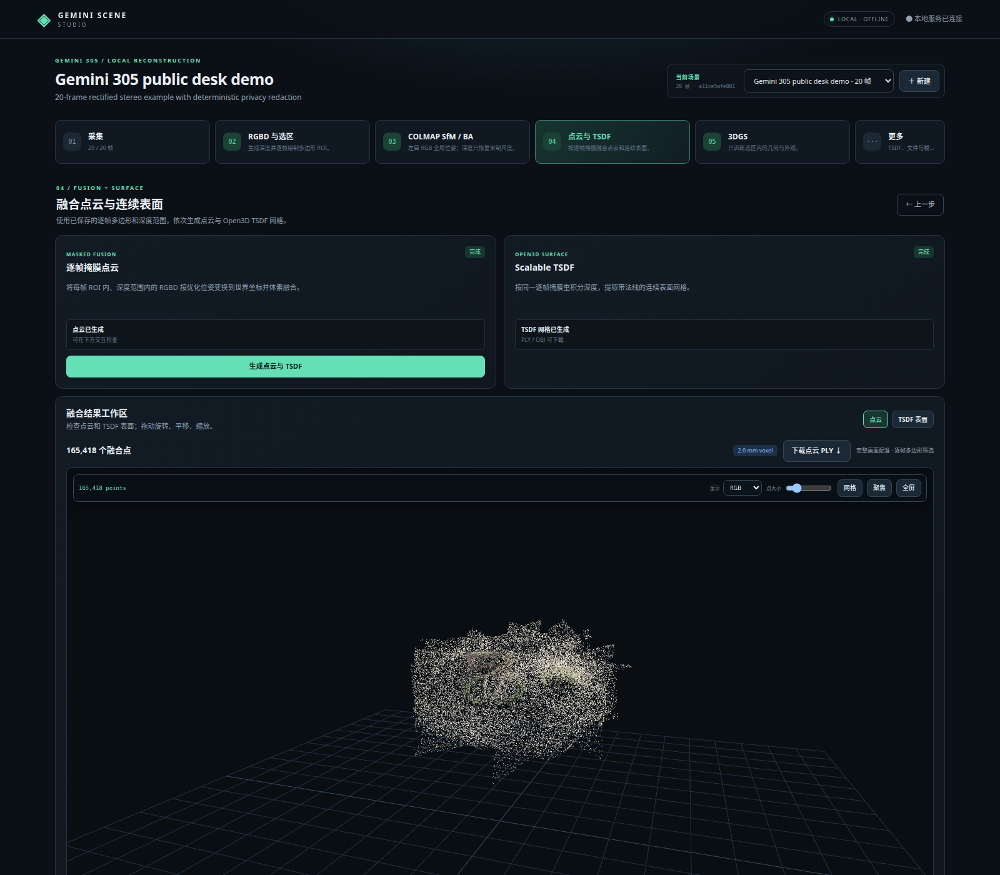

# Gemini Scene Studio

Gemini 305 双目离线重建工作台。C++17 主工程，面向最多20组同步、已校正双目图；Python负责深度/特征网络、COLMAP 编排、CUDA Gaussian 训练和测试工具。当前是可运行的研究基线，不是计量级产品。



## 可复现公开示例

仓库附带一套经过隐私脱敏的 Gemini 305 桌面场景：20 组 1280×800 已校正双目图、内参/基线、逐帧 ROI，以及 COLMAP 位姿、融合点云、TSDF 网格和 Gaussian Splat 精选结果。人员、工作屏幕、卡片文字、设备序列号、时间戳和本地路径均已处理；图像尺寸与标定没有改变。

仓库中的预计算结果可以直接离线查看。若要从20组双目图重新运行，先执行一次联网准备；第三方源码、约1.44 GB的 BridgeDepth 权重及 ALIKED/LightGlue 权重不会重复下载，准备完成后可断网运行：

```bash
# Ubuntu 24.04：先安装 git、curl、CMake、GCC、OpenCV开发包和COLMAP；
# 另需与显卡匹配的 NVIDIA 驱动/CUDA。
bash scripts/fetch_deps.sh
bash scripts/fetch_models.sh
python3 -m venv .venv
.venv/bin/pip install torch==2.7.0 torchvision==0.22.0 --index-url https://download.pytorch.org/whl/cu126
.venv/bin/pip install -e '.[gpu]'
bash scripts/build.sh
```

若使用不同 CUDA 版本，请按 PyTorch 官方安装器替换上面的 wheel 源。系统还需要可执行的 `colmap`；服务启动时 `scripts/doctor.py` 会记录 GPU 与 Python 包状态。

启动本地服务后，一条命令可重新运行完整示例：

```bash
bash scripts/start.sh 8787
# 另开一个终端
bash scripts/run_public_demo.sh 8787
```

只验证 RGB-D、COLMAP、点云和 TSDF，跳过 3DGS：

```bash
GEMINI_DEMO_SKIP_TRAIN=1 bash scripts/run_public_demo.sh 8787
```

数据说明、指标和下载产物见 [examples/desk-scene](examples/desk-scene/README.md)，公开数据的隐私处理与复现记录见 [PUBLIC_RELEASE](docs/PUBLIC_RELEASE.md)。

## 启动

推荐安装到 `$HOME/Tars_Project/gemini-scene-studio`，也可以从任意本地路径运行。

```bash
cd "$HOME/Tars_Project/gemini-scene-studio"
bash scripts/build.sh
bash scripts/start.sh 8787
```

访问 http://127.0.0.1:8787 。服务仅绑定回环地址，离线运行，无CDN依赖。首次训练需编译gsplat CUDA扩展，可能数分钟。启动前不要同时运行多个占显存的模型；程序不会替你结束其他任务。

## 流程

同步已校正双目 → BridgeDepth 米制深度 → 逐帧多边形 ROI → 左目 RGB ALIKED/LightGlue + COLMAP SfM/全局 BA → 深度观测恢复米制尺度 → 掩膜 RGB-D 点云 → Scalable TSDF 表面 → 几何约束 3DGS。
深度、位姿和点云另送入gsplat训练，产生Gaussian PLY、checkpoint、训练视图渲染和损失记录。

网页分别提供数据、深度、位姿、点云、TSDF、训练、产物、系统等页面；任务有日志、取消和依赖有效性检查。既有原始数据复制后处理，不原地修改。

## 目录约定

| 目录 | 内容 |
|---|---|
| apps/ | C++服务和几何CLI入口 |
| libs/、include/studio/ | 自研核心与重建库 |
| studio/ | Python模型worker、训练与测试数据生成 |
| web/ | 本地网页自研代码 |
| 3rdparty/ | 外部源码、头文件、运行库、前端库、下载与CUDA缓存 |
| models/ | 模型权重、哈希与来源清单 |
| data/ | 场景原始副本、版本化运行、日志和产物 |
| docs/ | 实施计划、页面设计、数据契约 |
| tests/ | C++单元测试和HTTP端到端烟雾测试 |

第三方库不混进自研源码。大文件不进Git，下载组件保留各自许可证；详见[依赖归档](3rdparty/README.md)。Python包由独立`.venv`管理，不手工搬进3rdparty以破坏安装元数据。

## 本机依赖与重建

已验证组合：GCC13、CMake3.28、OpenCV4.6、Open3D0.19、PyTorch2.7/CUDA12.6、gsplat1.5.3。Python虚拟环境复用本机`bridgedepth`环境的PyTorch，因此当前安装不是可搬迁的自包含发行包。

`scripts/fetch_deps.sh`恢复固定版本 C++/网页依赖、BridgeDepth 和 LightGlue 源码；`scripts/fetch_models.sh`从官方来源下载并校验 BridgeDepth 权重，同时预热 ALIKED/LightGlue 权重缓存。`scripts/archive_resources.py`仅用于从已有本机工程迁移资源。首次下载/安装需要联网，配置好后推理无需联网。

```bash
ctest --test-dir build --output-on-failure
python3 tests/smoke.py
# 已有合成场景执行10步CUDA烟雾测试：
python3 tests/smoke.py --scene <场景ID> --gpu
```

## 当前边界

- 已通过本机 Gemini 相机服务接入预览、参数和无损双目采集；C++ 主进程仍是服务代理，而不是直接链接厂商 SDK。离线导入须遵循[数据契约](docs/DATA_CONTRACT.md)。
- 当前 COLMAP 分支会保存完整 sparse model、稀疏点和 BA 后相机；它是左目单相机 SfM，不是双目 rig BA。
- TSDF输出表面网格，没有持久化体素场；它不是神经SDF。
- 训练为固定高斯数量、SH0、RGB+深度+初始表面锚定基线；没有增密、完整SDF损失或左右图联合训练。点云是初始化，TSDF尚未直接进入训练损失。
- 正式位姿后端只向特征与 SfM 阶段输入左目 RGB。ALIKED + LightGlue 提供全图像对对应，COLMAP 完成增量 SfM、稀疏三角化和固定内参全局 BA；BridgeDepth 不提供位姿初值，只在 BA 后恢复一个全局米制尺度，并用于点云、TSDF 与 3DGS。
- OmniVGGT、SIFT+RGB-D PnP 和 ICP 已退出默认流程，历史运行产物仍保留。PGSR 与完整可微 SDF 约束仍是后续适配项。
- 8GB适合分阶段、降分辨率、小规模验证，不保证所有新模型或20帧联合推理都能装入。真实几何精度需要标定、遮挡检查、留出视角与实测物体评估。

## 阅读与维护

项目现状、源码调用链、数据归档和 3DGS 升级路线已经集中整理到[项目文档导航](docs/INDEX.md)。新接手代码时优先阅读：

- [当前状态与审计](docs/CURRENT_STATUS.md)
- [源码流程与代码含义](docs/CODE_WALKTHROUGH.md)
- [数据与文件归档](docs/DATA_LAYOUT.md)
- [3DGS 质量与几何升级路线](docs/3DGS_ROADMAP.md)

详细设计历史见[实施计划](docs/PLAN.md)，页面设计见[UI_SPEC](docs/UI_SPEC.md)。

## 许可证

项目自研代码和公开示例按 [MIT License](LICENSE) 发布。`3rdparty/` 中的组件仍分别遵循各自的上游许可证。
