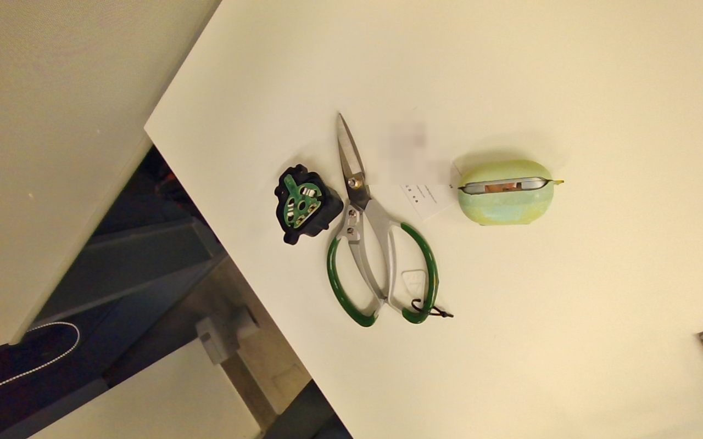
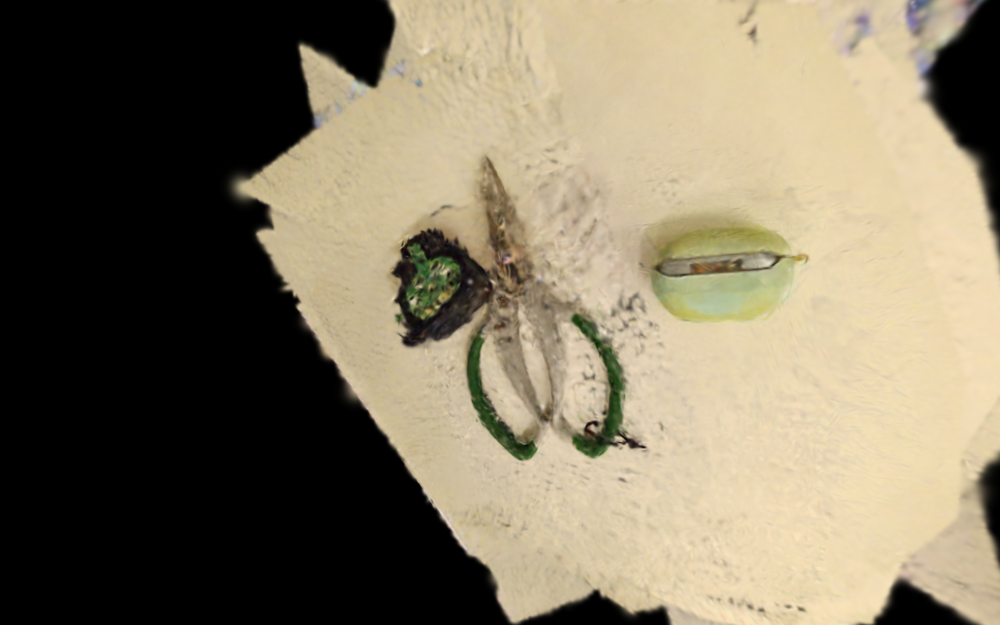

# Gemini 305 desk scene

This public example contains 20 synchronized, rectified Gemini 305 stereo pairs at 1280×800, camera intrinsics/baseline, per-frame ROI polygons, and selected reconstruction outputs.

People, work screens, printed card text, device serials, timestamps, and original source paths are removed from the public copy. Privacy masks are deterministic and recorded in `privacy_masks.json`; they do not resize or crop the images, so the published calibration remains valid. The original private frames are never modified.

After cloning the repository, import `scene/` from the web UI or run the normal offline pipeline described in the root README. Precomputed reference results are stored in `results/`:

- `poses.json`: COLMAP SfM/BA trajectory in metres.
- `fused_cloud.ply`: masked RGB-D fusion.
- `surface_mesh.ply`: Open3D TSDF surface.
- `gaussians.splat`: interactive Gaussian Splat.
- `novel_view.mp4`: interpolated-view preview.

The privacy-redacted input is a demonstration dataset, not a metrology benchmark. Redaction reduces some background texture and can change feature matching relative to the private capture.

## Verified public run

The redacted copy was rerun from scratch on an RTX 4060 Laptop GPU:

| Stage | Public example result |
|---|---:|
| COLMAP registration | 20 / 20 frames |
| Mean reprojection error | 1.08 px |
| Sparse points | 1,173 |
| Fused RGB-D cloud | 165,418 points |
| TSDF mesh | 37,103 vertices / 71,424 triangles |
| Baseline 3DGS | 80,000 Gaussians / 3,000 steps / 81.2 s |

Exact recorded values are in `results/metrics.json`.

